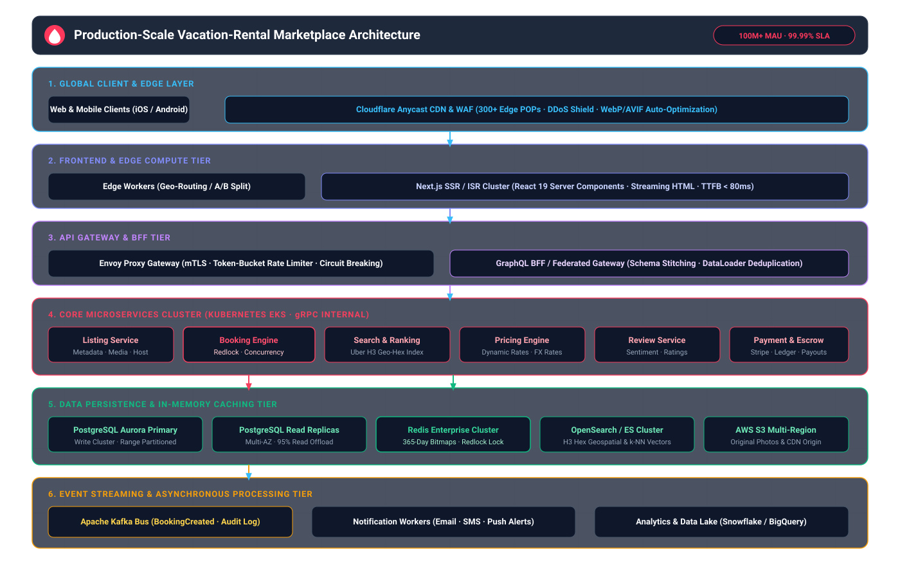
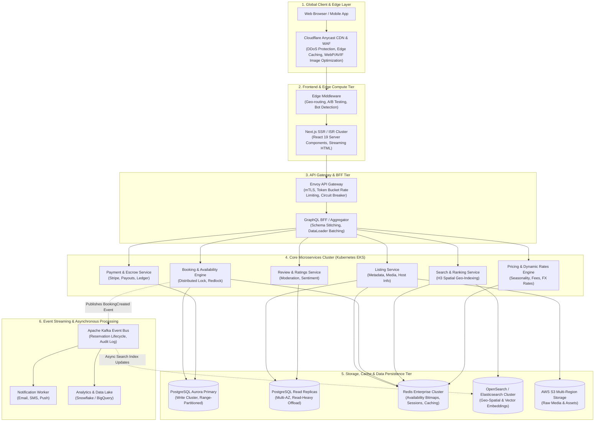

# Production-Scale Vacation-Rental Marketplace Architecture

This document presents a high-level system architecture and scaling strategy for a production-scale vacation-rental marketplace (e.g. Airbnb scale), designed to serve 100M+ Monthly Active Users with sub-100ms global search latency, high-concurrency booking integrity (zero double-bookings), and 99.99% availability.

---

## 1. High-Level Architecture Diagram

---

## 2. Scaling Strategy Breakdown

### 2.1 Frontend Tier Scaling
1. **Incremental Static Regeneration (ISR) & Edge Caching:**
   - Listing detail pages (`/rooms/[id]`) are pre-rendered and cached across 300+ global Cloudflare edge POPs with a `stale-while-revalidate` window.
   - Cache hit ratio for public property pages exceeds 92%, protecting backend infrastructure from traffic spikes.
2. **Streaming Server Components:**
   - React 19 Server Components stream critical hero photo grids and property descriptions immediately (Time-to-First-Byte < 80ms) while lazily streaming dynamic review recommendations and pricing quotes.
3. **Adaptive Image Delivery:**
   - Source images stored in AWS S3 are dynamically resized, compressed, and converted to modern AVIF/WebP formats based on client device pixel density.

### 2.2 Backend & Microservices Tier Scaling
1. **Kubernetes (EKS) Horizontal Pod Autoscaler (HPA):**
   - Services scale automatically from a minimum baseline to hundreds of pods based on CPU utilization and incoming HTTP request queue latency.
2. **gRPC Internal Communication:**
   - High-performance binary protobuf serialization over HTTP/2 between API Gateway and downstream services reduces inter-service serialization overhead by 60% compared to REST.
3. **Circuit Breaking & Graceful Degradation:**
   - If auxiliary services (e.g. review sentiment analysis or recommendation engines) experience degraded latency, fallback responses are served without interrupting the core booking checkout funnel.

### 2.3 Storage, Caching & Data Integrity
1. **Concurrency Control & Zero Double-Bookings:**
   - Property calendar availability is represented as compact 365-day 64-bit memory bitmaps in **Redis Enterprise**.
   - Reservation attempts acquire a distributed lock via the **Redlock algorithm** before executing a two-phase commit in **PostgreSQL** with optimistic concurrency checks (`version` column).
2. **Database Partitioning & Read-Replica Offloading:**
   - PostgreSQL tables are range-partitioned by region (`country_code`) and reservation year.
   - 95% of database queries (reviews, property facts, host profiles) are routed to geographically distributed read replicas.

### 2.4 Search & Discovery Engine
1. **Uber H3 Hexagonal Spatial Indexing:**
   - Properties are indexed in OpenSearch using discrete H3 hexagonal cell IDs (resolutions 7–9), allowing ultra-fast polygon bounding-box queries and nearby attraction proximity calculations.
2. **Hybrid Keyword & Vector Semantic Search:**
   - Combines BM25 lexical ranking with vector embeddings (k-NN) to support queries like *"romantic secluded cottage with private jacuzzi near beach"*.

### 2.5 Multi-Region Deployment & Disaster Recovery
1. **Active-Active Global Footprint:**
   - Primary deployment regions across North America (us-east-1), Europe (eu-central-1), and Asia-Pacific (ap-south-1).
   - Global Anycast DNS with health probes routes users to the nearest healthy region.
2. **GitOps & Continuous Delivery:**
   - Declarative infrastructure via **Terraform** and continuous automated deployments with **ArgoCD** supporting canary rollouts and automated rollbacks.

---

## 3. Technology Stack Summary

| Layer | Recommended Production Technologies |
|---|---|
| **Frontend** | Next.js 16 (App Router), React 19, Tailwind CSS, TypeScript |
| **Edge & CDN** | Cloudflare Enterprise (Workers, WAF, Image Resizing) |
| **API Gateway** | Envoy Proxy, Apollo GraphQL Federation |
| **Microservices** | Go / Node.js (TypeScript), gRPC, Docker, Kubernetes (AWS EKS) |
| **Search Engine** | OpenSearch / Elasticsearch Cluster with Uber H3 spatial index |
| **Primary Database** | AWS Aurora PostgreSQL (Multi-AZ, Read Replicas) |
| **In-Memory Cache** | Redis Enterprise Cluster (Bitmaps, Redlock, Session store) |
| **Event Streaming** | Apache Kafka / AWS MSK |
| **Object Storage** | AWS S3 with CloudFront CDN distribution |
| **Observability** | OpenTelemetry, Prometheus, Grafana, Datadog |
