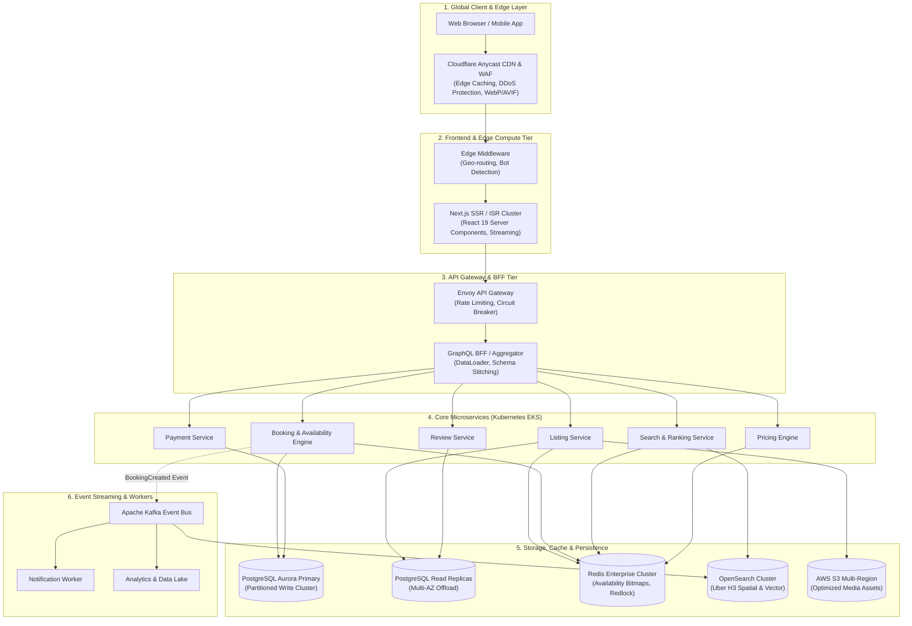

# 🏡 Airbnb Listing Page Clone & Production Architecture

> **PlayPower Labs Frontend Engineering & System Architecture Assignment**  
> A pixel-perfect, production-grade reproduction of the Airbnb property listing page for **Romantic Jacuzzi 1BHK Candolim | Mirashya UG10**, built with Next.js 16, React 19, TypeScript, and Tailwind CSS v4.

---

## 📑 Table of Contents
- [✨ Key Features Overview](#-key-features-overview)
  - [1. Main Listing Page Experience](#1-main-listing-page-experience)
  - [2. Full-Screen Photo Tour](#2-full-screen-photo-tour)
  - [3. Interactive Theater Lightbox](#3-interactive-theater-lightbox)
  - [4. Dynamic Sticky Booking & Pricing Widget](#4-dynamic-sticky-booking--pricing-widget)
  - [5. Interactive Modals & Sub-views](#5-interactive-modals--sub-views)
- [🏛️ Production-Scale System Architecture (100M+ MAU)](#️-production-scale-system-architecture-100m-mau)
- [🤖 AI Subagents & Skill Configurations](#-ai-subagents--skill-configurations)
- [🛠️ Tech Stack](#️-tech-stack)
- [📂 Project Directory Structure](#-project-directory-structure)
- [🚀 Getting Started & Local Setup](#-getting-started--local-setup)
- [✅ Verification & Quality Assurance](#-verification--quality-assurance)

---

## ✨ Key Features Overview

### 1. Main Listing Page Experience
- **Airbnb Navigation Header**:
  - Airbnb iconic brand logo with rose accent.
  - Interactive search capsule (*Anywhere · Any week · Add guests*).
  - Quick launcher for **System Architecture Modal**.
  - Save to Wishlist toggle with interactive counter and animated heart state.
  - Share modal launcher and user profile menu dropdown.
  - **Sticky Sub-Header on Scroll**: Triggers on scroll past hero with section tab indicators (*Photos, Amenities, Reviews, Location*) and a compact reserve CTA.
- **Hero Photo Grid (5-Tile Asymmetric Layout)**:
  - Exact Airbnb 5-tile asymmetric layout (1 prominent primary tile left, 4 secondary tiles right).
  - Rounded outer corners, subtle zoom transitions on hover, and custom cursor cues.
  - Floating **"Show all photos"** badge with 3x3 grid icon.
  - Direct click triggers opening either the full Photo Tour or Lightbox at that specific photo.
- **Listing Quick Facts & Superhost Badges**:
  - Property rating badge (`★ 4.92 · 48 reviews · Superhost · Candolim, Goa, India`).
  - Room specifications (`4 guests · 1 bedroom · 2 beds · 1 bath`).
  - Key highlights: *Dedicated workspace*, *Self check-in with keypad*, *Free cancellation for 48 hours*.
- **Sleeping Arrangements ("Where you'll sleep")**:
  - Visual room cards with bed icons for **Bedroom** (1 king bed) and **Living room** (1 sofa bed).
- **Amenities Section ("What this place offers")**:
  - Categorized amenities preview with custom icons (Private Jacuzzi, Pool, 150 Mbps Wi-Fi, Dedicated workspace, AC, 4K TV, Kitchen, Washer).
  - Full **"Show all 32 amenities"** modal with real-time category navigation and instant search filter.
- **Interactive Dual-Month Date Picker**:
  - Side-by-side dual-month calendar view for selecting check-in and checkout dates.
  - Live nights calculation, automated range highlighting, and clear dates capability.
- **Guest Reviews Section**:
  - 6-category rating breakdown with visual progress bars (*Cleanliness 4.9, Accuracy 4.9, Communication 5.0, Location 4.8, Check-in 5.0, Value 4.8*).
  - Review cards grid with reviewer avatars, locations, stay tenure, and verified testimonials.
  - Full **"Show all 48 reviews"** modal with search filter and rating highlights.
- **Location Map Section ("Where you'll be")**:
  - Interactive map simulation of Candolim / Pilerne Goa with custom Airbnb pin and pulsing radar effect.
  - Landmark guide with distances (*Candolim Beach 1.2 km, Aguada Fort 3.5 km, Calangute 4.0 km, Airport 32 km*).
- **Host Profile & Co-hosts ("Meet your Host")**:
  - Detailed host card for Mirashya: Superhost badge, 382 reviews, 4.94 rating, 2 years hosting.
  - Co-host profiles (Aman, Maria, Pallavi, Sanyukta, Sharath, Simran).
  - Verified host credentials and 100% response rate within an hour.
- **Things to Know & Similar Stays**:
  - Comprehensive House rules, Safety & property features, and Cancellation policies.
  - "More places to stay" carousel card recommendations in Candolim & North Goa.

---

### 2. Full-Screen Photo Tour
- Accessible via **"Show all photos"** or hero photo clicks.
- Sticky top navigation bar with Back button, Share, and Save actions.
- Room category filter tabs (*All, Living room, Bedroom, Jacuzzi & Pool, Kitchen & Dining, Bathroom, Balcony & Views*) with smooth scrolling.
- 18 high-resolution photos grouped by room with descriptive captions.
- Seamless transition into the **Lightbox view** upon clicking any photo.

---

### 3. Interactive Theater Lightbox
- Dark theater-mode overlay (`#000000`) matching Airbnb's exact viewer.
- Header counter (`e.g., 3 / 18`), Close (`✕`), Share, and Save buttons.
- Centered high-resolution image container with responsive aspect ratio.
- Left (`<`) and Right (`>`) arrow controls.
- **Full Keyboard Navigation**:
  - `ArrowLeft`: Previous photo
  - `ArrowRight`: Next photo
  - `Escape`: Close lightbox
- Interactive thumbnail filmstrip at the bottom with active photo indicator and instant-jump support.

---

### 4. Dynamic Sticky Booking & Pricing Widget
- Desktop sticky floating card with nightly price (₹4,599/night).
- Mobile bottom floating reserve bar.
- Interactive Date capsule input linked with the calendar.
- Guest counter popover (+/- stepper for Adults, Children, Infants, and Pets with capacity rules).
- Iconic Airbnb rose gradient **"Reserve"** button.
- Live itemized price breakdown:
  - `Base Price × Nights`
  - `10% Weekly Discount` (applied dynamically for stays ≥ 5 nights)
  - `Cleaning Fee`
  - `Airbnb Service Fee`
  - `Total before taxes`

---

### 5. Interactive Modals & Sub-views
- **System Architecture Modal**: In-app modal visualizing the full 100M+ MAU architecture diagram, tier-by-tier technical specifications, caching strategy, and database design.
- **Amenities Modal**: Complete directory of 32+ amenities categorized into Bathroom, Bedroom & Laundry, Entertainment, Heating & Cooling, Home Safety, Internet & Office, Kitchen & Dining, Location Features, Outdoor, and Parking.
- **Reviews Modal**: Searchable testimonial directory with individual category ratings and verified guest feedback.
- **Share Modal**: Copy listing link with toast confirmation, share to WhatsApp, Messenger, Twitter/X, Email, and Facebook.
- **Description Modal**: Full expanded text describing the property, space, guest access, and other details.

---

## 🏛️ Production-Scale System Architecture (100M+ MAU)

As required by the assignment, this project includes a comprehensive architectural design for scaling a vacation-rental platform to **100M+ Monthly Active Users (MAU)** with sub-100ms search latency, zero double-bookings, and 99.99% availability.

- 📄 **Full Architectural Specification**: [`ARCHITECTURE.md`](./ARCHITECTURE.md)
- 🖼️ **System Architecture Blueprint**: [`public/images/system_architecture.svg`](./public/images/system_architecture.svg) / [`public/images/system_architecture.jpg`](./public/images/system_architecture.jpg)

### Core Architecture Highlights:
1. **Frontend Tier & Global Edge (Cloudflare + Next.js SSR/ISR)**:
   - Incremental Static Regeneration (ISR) cached across 300+ Edge POPs with `stale-while-revalidate`.
   - React 19 Server Components for streaming critical hero photo grids and property descriptions (TTFB < 80ms).
   - Dynamic AVIF/WebP adaptive image pipeline.
2. **API Gateway & BFF Tier (Envoy + GraphQL)**:
   - Envoy API Gateway with mTLS, token-bucket rate limiting, and circuit breaking.
   - GraphQL BFF for schema stitching and DataLoader batching to eliminate N+1 queries.
3. **Microservices Cluster (Kubernetes EKS)**:
   - Domain-driven microservices (Listing, Booking, Search, Pricing, Reviews, Payments) communicating via high-performance gRPC (HTTP/2 protobuf).
4. **Zero Double-Booking & Data Integrity (Redis Redlock + PostgreSQL)**:
   - 365-day 64-bit availability memory bitmaps in Redis Enterprise.
   - Distributed locking via **Redlock** with PostgreSQL two-phase commits and optimistic concurrency control (`version` checks).
5. **Geo-Spatial Search (OpenSearch + Uber H3)**:
   - Discrete H3 hexagonal spatial indexing (resolutions 7–9) for bounding-box queries and hybrid vector k-NN semantic search.
6. **Asynchronous Event Processing (Apache Kafka)**:
   - Reservation lifecycle events, notifications, and search index updates processed asynchronously.



---

## 🤖 AI Subagents & Skill Configurations

This repository contains custom agent skill specifications and subagent configurations tailored for automated auditing and quality control:

- [`.agents/skills/accessibility-auditor/SKILL.md`](./.agents/skills/accessibility-auditor/SKILL.md): Automated WCAG 2.1 AA keyboard navigation, focus rings, and ARIA role auditor.
- [`.agents/skills/visual-parity-checker/SKILL.md`](./.agents/skills/visual-parity-checker/SKILL.md): Visual design token auditor (colors, spacing geometry, hover animations).
- [`agent-configs/code-quality-subagent.json`](./agent-configs/code-quality-subagent.json): TypeScript strictness, Next.js best practices, and component modularity rules.
- [`agent-configs/accessibility-subagent.json`](./agent-configs/accessibility-subagent.json): Screen reader accessibility and keyboard navigation rules.

---

## 🛠️ Tech Stack

| Domain | Technology / Library | Version / Details |
|---|---|---|
| **Framework** | Next.js (App Router) | `16.3.5` |
| **UI Library** | React | `19.2.8` |
| **Language** | TypeScript | `5.x` |
| **Styling** | Tailwind CSS v4 & PostCSS | `@tailwindcss/postcss ^4` |
| **Icons** | Lucide React | `^1.47.0` |
| **Date Utilities** | date-fns & react-day-picker | `date-fns ^4.4.0`, `react-day-picker ^10.0.1` |
| **UI Primitives** | Base UI / shadcn | `@base-ui/react`, `cmdk`, `class-variance-authority` |
| **Code Quality** | ESLint & Next.js ESLint Config | `eslint ^9`, `eslint-config-next 16.3.5` |

---

## 📂 Project Directory Structure

```text
├── .agents/
│   └── skills/
│       ├── accessibility-auditor/     # Automated accessibility & ARIA audit skill
│       └── visual-parity-checker/     # Airbnb visual parity & token checker skill
├── agent-configs/
│   ├── accessibility-subagent.json    # Accessibility subagent rules & checklist
│   └── code-quality-subagent.json     # Code modularity & TypeScript rules
├── app/
│   ├── favicon.ico
│   ├── globals.css                    # Tailwind CSS v4 design tokens & utilities
│   ├── layout.tsx                     # Root layout with Inter font & metadata
│   └── page.tsx                       # Main Airbnb Listing Page
├── components/
│   ├── ui/                            # Reusable base UI primitives
│   ├── amenities-modal.tsx            # Full 32+ amenities modal with search
│   ├── amenities-section.tsx          # Categorized amenities section preview
│   ├── architecture-modal.tsx         # System Architecture deep-dive modal
│   ├── date-range-picker.tsx          # Dual-month interactive calendar component
│   ├── description-modal.tsx          # Complete property & space description modal
│   ├── footer.tsx                     # Airbnb footer with region, currency & links
│   ├── header.tsx                     # Main navigation header & sticky sub-header
│   ├── host-section.tsx               # Host profile & co-hosts showcase
│   ├── lightbox-modal.tsx             # Fullscreen theater lightbox with keyboard nav
│   ├── location-map.tsx               # Interactive map & landmark distance guide
│   ├── more-stays.tsx                 # Similar places to stay recommendations
│   ├── photo-grid.tsx                 # 5-tile asymmetric hero photo gallery
│   ├── photo-tour-modal.tsx           # Fullscreen categorized photo tour modal
│   ├── reviews-modal.tsx              # Searchable guest reviews modal
│   ├── reviews-section.tsx            # 6-category rating breakdown & review cards
│   ├── share-modal.tsx                # Share modal with clipboard & social actions
│   ├── sleeping-section.tsx           # "Where you'll sleep" visual room cards
│   ├── sticky-reserve-card.tsx        # Sticky booking card with dynamic calculation
│   └── things-to-know.tsx             # House rules & cancellation policy
├── lib/
│   ├── listing-data.ts                # Listing data, photos, amenities, host details
│   ├── types.ts                       # TypeScript interfaces for listing, reviews, booking
│   └── utils.ts                       # Class merging (cn) utility
├── public/
│   ├── images/
│   │   ├── system_architecture.jpg    # High-resolution system architecture diagram
│   │   └── system_architecture.svg    # Vector system architecture diagram
│   └── photos/                        # 18 property photos, host avatar, co-host photos
├── ARCHITECTURE.md                    # 100M+ MAU System Architecture & Scaling Guide
├── package.json
├── tsconfig.json
└── README.md
```

---

## 🚀 Getting Started & Local Setup

### Prerequisites
- **Node.js**: `v18.17.0` or higher (Node.js 20+ recommended)
- **npm**: `v9.0.0` or higher

### Installation & Run Steps

```bash
# 1. Clone the repository
git clone https://github.com/kushalpatel8/playpower-labs-airbnb-clone-app-assignment.git

# 2. Navigate to the project directory
cd playpower-labs-airbnb-clone-app-assignment

# 3. Install project dependencies
npm install

# 4. Start the development server
npm run dev

# 5. Open in your browser
http://localhost:3000
```

### Building for Production

```bash
# Create an optimized production build
npm run build

# Start the production server
npm start
```

---

## ✅ Verification & Quality Assurance

- **Accessibility (WCAG 2.1 AA)**: All interactive modals, photo galleries, and lightbox viewers support keyboard traps, `Escape` key close, `ArrowLeft` / `ArrowRight` photo cycling, focus indicators, and semantic ARIA labeling.
- **Cross-Device Responsiveness**: Fluidly adapts from desktop (1440px / 1280px), laptop (1024px), tablet (768px), down to mobile (375px) with sticky bottom reserve bar.
- **Type Safety**: 100% strict TypeScript coverage with zero build or lint warnings.

---

### 👨‍💻 Author
**Kushal Patel**  
Assignment submission for **PlayPower Labs**.
